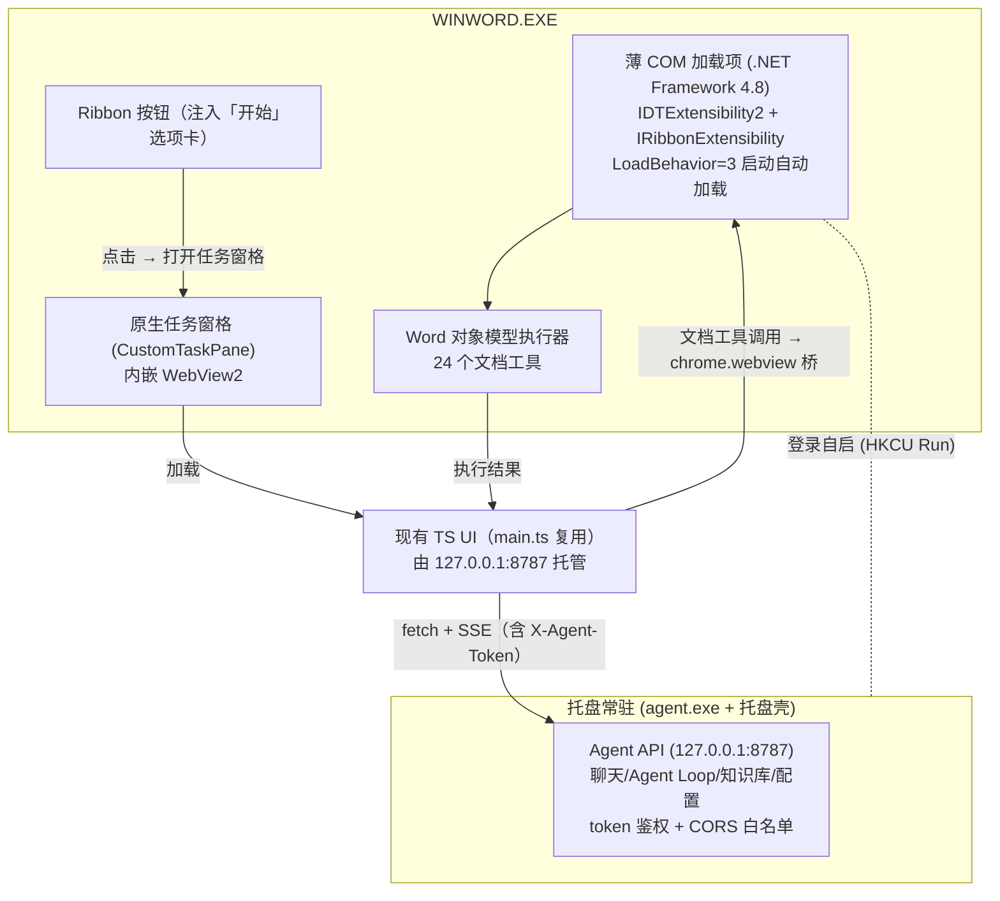

# Office Agent 桌面化重构 — 开工文档（Kickoff / Handoff）

> 本文档是 fork 新仓库后开工的**唯一信息入口**：包含决策记录、现状资产清点、目标架构、工作包分解、已知坑清单和验收标准。
> 目标读者：接手实现的人（或未来的 agent 会话）。读完本文 + 源码即可直接开工，不需要翻聊天记录。

---

## 1. 背景与决策记录

### 1.1 背景痛点（为什么重构）

1. **Web Add-in 注册不可靠**：`scripts/install.bat` 通过直写 WEF 缓存目录注册 manifest，属未公开机制，随 Office 版本失效（README 已注明"部分版本 office 无法全自动注册"），兜底方案是用户手动配信任中心 + 网络共享，体验差。
2. **本地服务体验差**：`scripts/start.bat` 弹黑色 CMD 窗口且必须常驻，关窗即失效；无开机自启；要求用户自装 Node.js 18+。
3. **安全面**（做成常驻服务前必须解决）：`apps/local-agent/src/server.ts` 中 `cors({ origin: true })` 反射任意 Origin 且 API 无鉴权，任意网页可跨域读取本地服务（`/v1/kb/export` 可拖走整个知识库、`/v1/kb/clear` 可清空、`/v1/chat/*` 可消耗模型额度）。

### 1.2 已定决策（不要在新仓库里重新讨论）

| # | 决策 | 说明 |
|---|------|------|
| D1 | **COM 薄壳替换 Web Add-in 注册**（"金山式"） | 薄 COM 加载项（Ribbon 按钮 + `LoadBehavior=3` 自动加载）+ WebView2 托管**现有 TS UI**，UI 代码（`apps/word-addin/src/main.ts` 等）尽量原样复用 |
| D2 | **建议 2：托盘化 + exe 打包** | 本地 Agent 编译为独立 `agent.exe`（去 Node 依赖），托盘常驻、开机自启、单实例、右键菜单（打开面板/重启服务/退出） |
| D3 | **文档工具层从 Office.js 迁到 Word 对象模型** | 24 个工具在 COM 侧用 Word OM 执行，经 WebView2 桥/本地 IPC 与 UI 通信（详见 §6.4） |
| D4 | **统一安装器（Inno Setup）** | 一个 `Install.exe` 完成：安装托盘程序 + COM 注册 + 自启配置 + 开始菜单/卸载项；删除全部 WEF/信任中心/共享目录流程 |
| D5 | **安全加固是 M1 项** | 启动时生成随机 token，请求头校验；CORS 白名单只放插件来源 |

### 1.3 已否决方案（不要走回头路）

| 方案 | 否决理由 |
|------|----------|
| `pkg` 打包 Node 服务 | 已停止维护（停在 Node 18）；改用 esbuild + Node SEA / Bun compile |
| 全量 VSTO/WinForms 重写 UI | 成本 2~6 周，收益主要就是 COM 的注册可靠性；薄壳 + WebView2 复用 UI 以 ~1/3 成本获得同样收益 |
| Web Add-in + TrustedCatalogs 注册表 | 可作为历史参考，但被 D1 取代；该路线仍绕不开 HTTPS/UNC 共享目录，可靠性仍弱于 COM 注册 |
| Windows Service 形态 | 用户级配置、%APPDATA% 路径、桌面交互都更麻烦；用 HKCU Run 键自启即可 |
| AppSource / 跨平台（Mac/Web 版 Word） | 本产品定位 Windows 桌面 Word 本地 Agent，明确放弃 |

---

## 2. 现有仓库资产清点

### 2.1 仓库与开发环境

- 仓库：`https://github.com/Kenp-viewsonic/officeAgent.git`（分支 `main`，本文档写入时工作区干净）
- monorepo：npm workspaces（根 `package.json`）
- Node.js 18+；TypeScript 5.7；Vite 6；Express 4
- 开发命令（源码运行）：
  ```bash
  npm install                 # 根目录装依赖
  npm run dev:agent           # 本地 Agent：http://127.0.0.1:8787（tsx watch）
  npm run dev:addin           # 插件前端：https://localhost:3001（Vite HTTPS，代理 /api → 8787）
  ```
  - Vite dev 证书读取 `%USERPROFILE%\.office-addin-dev-certs\`（首次需 `npx office-addin-dev-certs install`）
  - 开发侧载：`apps/word-addin/manifest.xml`（指向 `https://localhost:3001`）
- 生产打包：`npm run package` → `scripts/package.ps1` → 产出 `dist/`（`manifest.xml` + `install/start/stop/uninstall.bat` + `logo.ps1` + `README.md` + `server/`〔编译产物 + `public/` 前端 + `node_modules`〕）
- 生产运行：`dist/start.bat`（前台 `node server.js`，端口 8787，同源托管前端 `server/public`）

### 2.2 关键常量

| 项 | 值 | 备注 |
|----|----|------|
| Agent 端口 | `8787`（`PORT` 环境变量可覆盖） | 绑定 `127.0.0.1`（`AGENT_BIND_HOST`） |
| Vite dev 端口 | `3001`（HTTPS） | 仅开发用 |
| Web Add-in Id | `6c55b4c0-9f66-4a95-8fb9-df8e2a4f1f11` | **随 Web Add-in 路线一起废弃**；COM 侧新 ProgID/CLSID 实现时生成 |
| 数据目录 | `path.resolve(process.cwd(), "data")`（`store.ts:5`） | 即服务进程工作目录下的 `data/`。**打包进 Program Files 后不可写，必须迁到 `%LOCALAPPDATA%\OfficeAgent\data`** |
| 静态前端 | `import.meta.dirname/public`（`server.ts:37`） | SEA 打包后 `import.meta.dirname` 语义变化，需改为 exe 相对路径或 SEA asset（见 §6.5） |

### 2.3 源码资产（保留 / 改造 / 废弃）

| 文件 | 行数 | 处置 |
|------|------|------|
| `apps/word-addin/src/main.ts` | 3930 | **保留改造**：UI/聊天/知识库/预设全部复用；仅替换文档工具执行层（`Word.run` 14 处 → WebView2 桥，dispatch 在 2379~2953 行） |
| `apps/word-addin/src/styles.css` | 782 | 原样保留 |
| `apps/word-addin/src/office.d.ts` | 121 | 工具迁移完成后废弃 |
| `apps/word-addin/manifest.xml`、`scripts/manifest-production.xml` | — | **废弃**（Web Add-in 注册机制整体退役） |
| `apps/local-agent/src/server.ts` | 1175 | 保留改造：+token 鉴权、+CORS 白名单、+doc-tool 桥接端点（若走方案 B）、data 目录迁移 |
| `apps/local-agent/src/llm.ts` | 1728 | 原样保留（24 个工具 schema 定义在此，55~497 行） |
| `apps/local-agent/src/tool-runtime.ts` | 392 | 原样保留（Agent Loop / doom-loop 检测） |
| `apps/local-agent/src/{store,retrieval,agent-session,agent-logger,types}.ts` | ~700 | 保留；`store.ts` 的 dataRoot 改 `%LOCALAPPDATA%` |
| `scripts/install.bat`、`uninstall.bat`、`start.bat`、`stop.bat` | — | **废弃**，由 Inno Setup 安装器 + 托盘程序取代 |
| `scripts/package.ps1` | — | 改造：输出物从 `dist/` zip 改为安装器输入（agent.exe + 前端 + 托盘壳） |
| `plans/*.md`（本文档等） | — | 全部随 fork 带走，作历史参考 |

### 2.4 API 面（server.ts 路由清单，改造时勿破坏）

```
GET  /health                      GET  /v1/provider/config        POST /v1/provider/config
GET  /v1/provider/models          GET  /v1/presets                POST /v1/presets
DELETE /v1/presets/:id            POST /v1/presets/:id/activate
GET  /v1/kb/stats                 GET  /v1/kb/files               POST /v1/kb/upload
DELETE /v1/kb/files/:fileName     DELETE /v1/kb/clear             GET  /v1/kb/export
POST /v1/kb/import
POST /v1/chat                     POST /v1/chat/stream            POST /v1/chat/agent-stream
POST /v1/chat/agent-continue      POST /v1/chat/abort
GET  *  → 静态托管前端（生产）
```

---

## 3. 目标架构



要点：
- **UI 与 Agent 的 HTTP 协议不变**，聊天/知识库/预设零改动。
- **唯一的大改动是工具执行位置**：从"任务窗格里的 Office.js"搬到"COM 加载项里的 Word OM"。
- Word 一启动 Ribbon 按钮就自动存在（COM 注册机制），点击才初始化 WebView2（不拖慢 Word 启动）。

---

## 4. 工作包分解

### WP0 · Fork 与仓库骨架（0.5 天）
- Fork 新仓库（见 §8），`plans/` 全带过去；建 `feat/*` 工作分支。
- 新增目录建议：`apps/com-host/`（C# 解决方案）、`apps/tray/`（托盘壳）、`installer/`（Inno Setup 脚本）。
- GitHub Actions：windows runner 上跑 `npm run package` 冒烟（能构建出安装器即绿）。

**验收**：新仓库可完整构建出与旧 `dist/` 等价的产物。

### WP1 · 安全加固 + 托盘化（2~3 天，可独立发版）
1. token 鉴权：服务启动时生成随机 token 存 `%LOCALAPPDATA%\OfficeAgent\agent.token`（ACL 收紧为当前用户），前端启动时带上 `X-Agent-Token`；所有 `/v1/*` 校验（`/health` 除外）。
2. CORS：白名单只允许 `http://127.0.0.1:8787` 自身来源，禁止反射任意 Origin。
3. `agent.exe` 打包：esbuild 把 local-agent 打成单文件 → Node 20+ SEA（或 `bun build --compile`）；`package.json` 中 `import.meta.dirname`/`process.cwd()` 的资源与数据路径按 §6.5 改造。
4. 托盘壳（Tauri v2 / Go systray / Electron 三选一，推荐 Tauri v2）：菜单 = 打开面板 / 重启服务 / 查看日志 / 退出；单实例锁；端口占用自动处置（把 `start.bat` 的检测/杀进程逻辑搬进来）。
5. 开机自启：HKCU `...\CurrentVersion\Run` 键指向托盘 exe（静默启动）。
6. 数据目录迁移：`data/` → `%LOCALAPPDATA%\OfficeAgent\data`（含旧数据一次性迁移逻辑）。

**验收**：不装 Node 的干净 Win10/11 上，安装后托盘常驻；浏览器恶意页面无法读取任何 `/v1/*`（可用控制台 `fetch('http://127.0.0.1:8787/v1/kb/export')` 验证返回被拒）；重启机器服务自动在。

### WP2 · COM 薄壳最小闭环（3~5 天）
1. C# 类库（.NET Framework 4.8，`ComVisible`）实现 `IDTExtensibility2` + `IRibbonExtensibility`。
2. Ribbon XML：`<tab idMso="TabHome">` 注入 Group + "打开助手" 按钮（图标沿用 `apps/word-addin/public/*.png`）。
3. 点击按钮 → 创建 CustomTaskPane，内嵌 WebView2 → 导航到 `http://127.0.0.1:8787`（服务未启动则提示并拉起托盘程序）。
4. 注册脚本：`regasm /codebase`（注意 Office 位数，见 §6.1）；写 `HKCU\Software\Microsoft\Office\Word\Addins\<ProgId>`（`LoadBehavior=3`）。
5. 卸载：删除上述键 + CLSID 注册。

**验收**：安装后重启 Word，「开始」选项卡自动出现按钮（无任何信任中心配置）；点击打开的 UI 与现在的任务窗格 UI 一致；纯聊天功能可用（文档工具此阶段仍不可用属预期）。

### WP3 · 工具层迁移（1~2 周，最大工作量）
1. 逐工具把 `Word.run`（Office.js）实现翻译为 Word OM（C#），工具清单见 §6.4。
2. IPC 通道：**方案 A（推荐）** WebView2 `window.chrome.webview.postMessage` 桥，COM 侧同步/异步执行后回传结果；**方案 B（兜底）** UI 把工具调用 POST 给 agent → COM 侧长轮询取任务 → 结果回填。方案 A 保持 `main.ts` 的 `executeTool()` 结构不变，只换执行器，改动面最小。
3. `main.ts` 中保留 Office.js 执行器作为运行时开关的 fallback，直到工具回归全部通过后摘除 `office.d.ts` 与 `@microsoft/office-js` 依赖。
4. 撤销语义：Word OM 执行前用 `Application.UndoRecord.StartCustomRecord` 包裹（用户一次 Ctrl+Z 回滚一整个工具动作）。

**验收**：24 个工具在 M365 桌面 Word 全部通过回归用例（每个工具至少 1 条，含空文档/长文档/表格/中文内容）；Office.js 依赖从 package.json 移除。

### WP4 · 统一安装器（2~3 天）
- Inno Setup 脚本（`installer/`）：
  - 装 `agent.exe` + 托盘壳 + COM DLL + 图标到 `C:\Program Files\OfficeAgent\`（admin 模式）
  - 注册 COM（按 Office 位数选 32/64 位 regasm；或双位数注册表都写）
  - HKCU Run 自启键；开始菜单快捷方式；ARP 卸载项
  - 卸载脚本完整清理：COM 注册、Run 键、`%LOCALAPPDATA%\OfficeAgent`（可保留用户数据选项）
- `scripts/` 里旧的 install/start/stop/uninstall.bat 与 manifest 全部删除；README 改为"双击 Install.exe → 打开 Word → 开始选项卡点 Word Agent"。

**验收**：全新虚拟机（无 Node、无开发工具）双击安装 → 重启 Word → 按钮在功能区 → 能聊天能改文档；卸载后注册表无残留（用 §6.1 的 reg query 验证）。

### WP5 · 验证矩阵 + 可选签名（持续）
见 §7。如需过企业"要求受信任发布者签署加载项"策略，购买代码签名证书对 COM DLL / agent.exe 签名（可选项，排期外）。

---

## 5. 建议节奏

M0(WP0) → M1(WP1，可先发一版"托盘 + 安全"改进包) → M2(WP2) → M3(WP3) → M4(WP4) → M5(WP5)。
WP1 与 WP2 无依赖，可并行两人。

---

## 6. 关键技术细节与已知坑

### 6.1 COM 注册（核心机制，"金山式"的全部秘密）

```
; 用户加载项键（Word 启动扫描这里）
HKCU\Software\Microsoft\Office\Word\Addins\<ProgId>
    FriendlyName (REG_SZ)   = "Word Agent"
    Description  (REG_SZ)   = "..."
    LoadBehavior (REG_DWORD)= 3      ; 3=随 Word 启动自动加载（9 也常见）
; COM 类注册（regasm /codebase 生成）
HKCU\Software\Classes\CLSID\{...}\InprocServer32  (或 HKLM\SOFTWARE\Classes\...)
```

- **位数**：32 位 Office 装在 64 位 Windows 上时（很常见），注册要走 `WOW6432Node`，用 32 位 `C:\Windows\Microsoft.NET\Framework\v4.0.30319\regasm.exe`；64 位 Office 用 `Framework64` 的 regasm。探测方法：
  - C2R（M365 / 2019+ 默认）：`HKLM\SOFTWARE\Microsoft\Office\ClickToRun\Configuration` → `Platform` 值为 `x86` 或 `x64`；
  - MSI：看 `HKLM\SOFTWARE\Microsoft\Office\16.0\Word\InstallRoot` 是否位于 `WOW6432Node` 下。
  - 兜底：两套视图都注册（安装器分别调用两个 regasm，失败忽略）。
- **LoadBehavior 被 Word 改写**：插件崩溃后 Word 弹"禁用项目"，LoadBehavior 被重置为 2/8。用户可在 `文件 → 选项 → 加载项 → 管理: 禁用项目` 恢复。**不要做"服务守护把 3 写回去"这种自愈流氓行为。**
- **可见的验证命令**（装完/卸完都要跑）：
  ```powershell
  reg query "HKCU\Software\Microsoft\Office\Word\Addins" /s
  reg query "HKLM\SOFTWARE\Microsoft\Office\Word\Addins" /s
  reg query "HKLM\SOFTWARE\WOW6432Node\Microsoft\Office\Word\Addins" /s
  ```
- 首选 **纯 COM（IDTExtensibility2）+ .NET Framework 4.8 + regasm**，不走 VSTO：VSTO 需额外 VSTO Runtime 且工具链老化；.NET 8 注册 COM 更繁琐（无 regasm，需手写注册表或 DllComServer）。

### 6.2 Ribbon

- `IRibbonExtensibility.GetCustomUI` 返回 Ribbon XML；按钮回调在 COM 侧 C# 方法。
- 注入「开始」选项卡用 `<tab idMso="TabHome">`（与现在 manifest 的 `<OfficeTab id="TabHome">` 位置一致，用户无感知迁移）。
- 图标：16/32/80 三档 PNG（复用 `apps/word-addin/public/`）。

### 6.3 WebView2 托管

- 依赖 WebView2 Evergreen Runtime：Win10/11 + 新版 Office 基本自带（Office Web Add-in 宿主就是 WebView2）；安装器里加检测 + 引导安装（官方 bootstrapper）作为兜底。
- `UserDataFolder` 显式设为 `%LOCALAPPDATA%\OfficeAgent\WebView2`，避免写 Program Files。
- **延迟初始化**：点按钮才创建 WebView2，关闭窗格可销毁或保活（保活更快但占内存，自行取舍）。
- 任务窗格用原生 CustomTaskPane（右侧停靠），与现在 Web Add-in 任务窗格体验一致。

### 6.4 文具工具迁移清单（WP3 的工作量所在）

`llm.ts` 定义 24 个工具（55~497 行），`main.ts` 2379~2953 行 dispatch。迁移映射方向：

| 工具 | main.ts dispatch 行 | Word OM 方向 |
|------|--------------------|--------------|
| read_document | 2600 | `Document.Content.Text` / 分块读取（大文档注意） |
| get_selection_info | 2605 | `Application.Selection` |
| get_document_stats | 2610 | `Document.ComputeStatistics` |
| get_paragraph_format | 2615 | `Paragraph.Format` |
| get_document_tables | 2620 | `Document.Tables` 枚举 |
| read_table | 2625 | `Table.Cell(r,c).Range.Text` |
| insert_at_cursor | 2630 | `Selection.TypeText` |
| insert_after_heading | 2379 | 标题样式查找 + `Range.InsertAfter` |
| insert_at_end / insert_at_start | 2450 / 2481 | `Document.Content` 首尾 Range |
| insert_after_paragraph | 2514 | Paragraph 索引定位 + Range |
| delete_paragraph | 2557 | `Paragraph.Range.Delete` |
| find_and_replace | 2585 | `Content.Find.Execute` |
| replace_selection / replace_paragraph | 2425 / 2671 | Range 赋值 / Paragraph.Range |
| set_paragraph_style / apply_rich_format | 2701 / 2743 | `Paragraph.Style` / Font & ParagraphFormat |
| merge_paragraphs | 2714 | Range 拼接删除 |
| undo_last_action | 2799 | `Application.Undo` |
| delete_table / insert_table | 2808 / 2829 | `Table.Delete` / `Tables.Add` |
| insert_mermaid_image | 2953 | 现逻辑生成图片后 `InlineShapes.AddPicture` |
| reply_only / task_complete | 2791 / （agent侧） | 不涉文档，不动 |
| read_image | （见 llm.ts 感知工具分组 1539/1544） | `InlineShapes` 导出字节，实现时以 `getToolsForProvider` 输出为准 |

注意：
- Office.js 的 `context.sync()` 批量语义 → Word OM 是即时调用，**必须用 `Application.ScreenUpdating=false` + `UndoRecord` 包裹**，否则长程 autopilot 的多轮编辑会非常慢且撤销栈碎裂。
- 选区/插入点语义有差异（Office.js `getRange` vs Word OM `Selection/Range`），逐工具写回归用例。

### 6.5 打包（agent.exe）

- **esbuild** 打包 `apps/local-agent` → 单 JS（express/multer/mammoth/zod 均为纯 JS，可打包）→ **Node 20+ SEA** 或 **Bun compile** 出 `agent.exe`。不要用 pkg（停维护）。
- 已知坑：
  - `server.ts:37` 的 `import.meta.dirname`、`store.ts:5` 的 `process.cwd()/data` 在 SEA 下都要改（资源用 exe 相对路径；数据用 `%LOCALAPPDATA%\OfficeAgent\data`）。
  - `multer`/`mammoth` 运行时读文件/模板的行为在 SEA 下需冒烟验证（必要时把这两处留在外部资源目录）。
  - 端口 8787 被占的处置逻辑进托盘（原 `start.bat` 里已有实现可搬）。

### 6.6 安全（WP1，常驻前必做）

- 现状：`server.ts` `cors({ origin: true })` + 无鉴权 = 任意网页可读知识库（`/v1/kb/export` 311 行）、删知识库（`/v1/kb/clear`）、烧额度（`/v1/chat/*`）。`/v1/provider/config` 只返回 `hasApiKey` 不回明文（这点没问题，保持）。
- 目标：`X-Agent-Token` 请求头 + CORS 白名单；token 文件 ACL 仅当前用户可读；WebView2 侧由桥/注入头带上 token。

### 6.7 验证时必看的 Office 行为

- Word 崩溃 → "禁用项目"把插件关掉（LoadBehavior 被改），需在文档里给用户恢复路径说明。
- 企业策略 `要求受信任的发布者签署应用程序加载项` 会拦未签名 COM 插件 → 代码签名是规避手段（WP5 可选项）。

---

## 7. 验证矩阵

| 维度 | 覆盖 |
|------|------|
| Office 版本 | M365 当前渠道、Office 2021 LTSC、Office 2019、Office 2016 |
| 位数 | 32 位 / 64 位 Office（各至少一台） |
| 系统 | Win10 22H2、Win11 |
| 场景 | 全新安装 / 覆盖升级 / 卸载无残留 / 无 Node 环境 / 服务未启动时点按钮 / Word 崩溃后恢复 / 大文档(100+ 页)工具耗时 |
| 安全 | 恶意网页读本地 API 被拒；卸载后 8787 无服务 |

---

## 8. Fork 操作说明（你来执行）

1. GitHub 上 fork `Kenp-viewsonic/officeAgent` → 建议命名 `officeAgent-desktop`（保持原仓库作为 Web Add-in 发布线，两条产品线互不干扰；`local-agent` 侧后续修复可互相 cherry-pick）。
2. fork 后第一件事：把本文件确认在 `plans/com-shell-migration-kickoff.md`，并在新仓库 README 顶部加一行指向它。
3. 分支策略：`main` 保持可构建；`feat/wp1-tray`、`feat/wp2-com-shell`、`feat/wp3-tool-migration` 分支推进。
4. 若需要 CI：GitHub Actions `windows-latest` runner，Node 20，跑 `npm install && npm run package` 冒烟。
5. 新仓库需要生成的新标识（实现 WP2 时）：COM ProgID（如 `OfficeAgent.Addin`）、CLSID（`uuidgen`）、Ribbon 团队/产品名；**不要复用**旧 Web Add-in 的 GUID `6c55b4c0-9f66-4a95-8fb9-df8e2a4f1f11`。

---

## 9. 风险登记

| 风险 | 等级 | 缓解 |
|------|------|------|
| Word OM 线程模型（STA）：WebView2 桥回调线程不在 Word 主线程 | 高 | 用 `TaskPane` 宿主 + `SynchronizationContext`/`Control.Invoke` 封送；工具执行统一经一个调度器 |
| 32/64 位 Office 注册表视图搞错 → 装完没按钮 | 高 | 安装器探测位数；验证矩阵含 32 位 Office |
| Office 2016 RTM 环境 WebView2 运行时缺失 | 中 | 安装器检测 + 官方 bootstrapper 兜底提示 |
| 大文档 Word OM 调用性能 | 中 | `ScreenUpdating=false` + 分块读取 + UndoRecord 合并 |
| 企业策略禁用未签名 COM 加载项 | 中 | 文档注明；代码签名列为 WP5 可选项 |
| SEA 打包后 mammoth/multer 运行时行为异常 | 中 | WP1 冒烟用例；必要时资源外置 |
| Word 崩溃后 LoadBehavior 被重置、用户"按钮消失" | 低 | FAQ 文档：禁用项目恢复步骤；不做自愈 |

---

## 10. Definition of Done（整体）

1. 干净 Win10/11（无 Node）双击 `Install.exe` → 重启 Word → 「开始」选项卡自动出现 Word Agent 按钮。
2. 点击按钮打开任务窗格 UI，聊天、知识库、预设、24 个文档工具全部可用（回归通过）。
3. 托盘常驻：开机自启、重启服务、退出；无 CMD 窗口。
4. 恶意网页无法读取本地 API（安全用例通过）。
5. 卸载后：注册表无残留（§6.1 三条 reg query 全空）、进程全停、快捷方式移除。
6. 验证矩阵全绿（或已知差异写入 README）。
